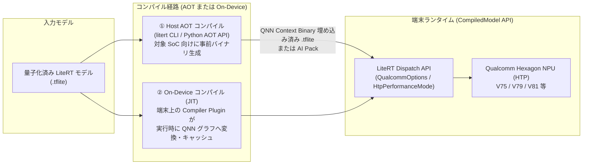

# LiteRT Next における Qualcomm NPU (AI Engine Direct / QNN) 統合調査レポート

本レポートでは、Google AI Edge の次世代ランタイム仕様である **LiteRT Next**（`developers.google.com/edge/litert/next/qualcomm` / `litert/vendors/qualcomm`）における **Qualcomm NPU（Hexagon Tensor Processor: HTP）** 向けの機能、コンパイルパイプライン、および量子化との関わりについて整理します。

---

## 1. 概要：従来の TFLite QNN Delegate から何が変わったのか？

従来、TensorFlow Lite で Qualcomm の NPU を利用するには、Qualcomm が外付けで提供する **TFLite QNN External Delegate** を開発者自身が組み込み、SoC ごとのライブラリ管理や複雑な初期化コードを記述する必要がありました。

**LiteRT Next** では、Google と Qualcomm の共同設計による **「LiteRT Qualcomm AI Engine Direct Accelerator」** がランタイムのファーストクラス機能として統合され、以下の点が刷新されています。

1. **`CompiledModel` API による統一的な NPU 抽象化**
   * デリゲートの手動アタッチが不要になり、`CompiledModel.Options(Accelerator.NPU)` を指定するだけで、対象端末の Qualcomm Hexagon NPU (HTP) を自動検出し、非対応オペレータや非対応端末では GPU / CPU へシームレスにフォールバックします。
2. **AOT（事前コンパイル）と On-Device（JIT）のハイブリッド対応**
   * 開発ホスト（x86 Linux）上で事前に特定 SoC 向けの QNN コンテキストバイナリを埋め込む **AOT コンパイル** と、端末上で初回実行時にコンパイルする **On-Device コンパイル** の双方を単一のワークフローで扱えます。
3. **Zero-Copy ハードウェアバッファ共有 (`TensorBuffer`)**
   * Android の `AHardwareBuffer` 等と QNN の共有メモリを直接バインドし、CPU ⇄ NPU 間のメモリコピーオーバーヘッドを排除しています。
4. **Google Play On-Device AI（AI Pack）との統合**
   * SoC モデル（`SM8750`, `SM8650` 等）ごとに AOT コンパイルしたバイナリを `--export-aipack` でパッケージ化し、ユーザーの端末 SoC に合致するバイナリだけを Google Play から動的配信する仕組みが導入されています。

---

## 2. アーキテクチャと2つのコンパイル方式

LiteRT Next の Qualcomm 統合（リポジトリ内の `litert/vendors/qualcomm`）は、**Qualcomm AI Runtime (QAIRT) / QNN SDK** をバックエンドとして利用し、大きく **Compiler Plugin** と **Dispatch API** の2層で構成されています。



### 2.1 AOT (Ahead-Of-Time) コンパイル
大規模モデルや LLM / VLM（Gemma、FastVLM 等）では、端末上での初回コンパイル時間やメモリ消費を避けるため、ホスト環境（Ubuntu 22.04 等の x86_64 Linux）で事前コンパイルする AOT 方式が推奨されています。

* **LiteRT CLI (`litert-cli-nightly` + `ai-edge-litert-sdk-qualcomm`) による実行例**:
  ```bash
  # 単一 SoC ターゲット (例: Snapdragon 8 Elite = sm8750) 向けに AOT コンパイル
  litert compile model_quantized.tflite --target sm8750

  # 複数世代の Snapdragon 向けにコンパイルし、Google Play 配信用 AI Pack を出力
  litert compile model_quantized.tflite \
    --target sm8750 \
    --target sm8650 \
    --export-aipack my_qualcomm_npu_aipack
  ```
* **Python AOT API による実行例**:
  ```python
  import ai_edge_litert as litert
  from litert.python.aot.vendors.qualcomm import target as qc_target

  target_soc = qc_target.Target(soc_model=qc_target.SocModel.SM8750)
  compiled_model = litert.compile(model_path="model_quantized.tflite", target=target_soc)

  with open("model_sm8750.tflite", "wb") as f:
      f.write(compiled_model.buffer())
  ```

### 2.2 On-Device コンパイル (JIT / On-Device Caching)
標準の `.tflite` ファイルをそのままアプリに同梱し、実機上の LiteRT ランタイムが QNN HTP バックエンド向けにサブグラフを分割・コンパイルする方式です。少量〜中規模の視覚・音声モデルでビルドパイプラインをシンプルに保ちたい場合に適しています。

### 2.3 主な対応 Snapdragon SoC と HTP アーキテクチャ対応表

| Snapdragon 製品名 | `SOC_MODEL` 識別子 | Hexagon HTP アーキテクチャ (`HTP_ARCH`) |
| :--- | :--- | :--- |
| **Snapdragon 8 Elite Gen 5** | `SM8850` | `V81` |
| **Snapdragon 8 Elite** | `SM8750` | `V79` |
| **Snapdragon 8 Gen 3** | `SM8650` | `V75` |
| **Snapdragon 8 Gen 2** | `SM8550` | `V73` |
| **Snapdragon 8+ Gen 1 / 8 Gen 1** | `SM8475` / `SM8450` | `V69` / `V68` |

---

## 3. ランタイム制御オプション (`QualcommOptions`)

`CompiledModel` API には、Qualcomm NPU 固有のハードウェア挙動やコンパイル最適化レベルを制御するための **`QualcommOptions`** が用意されています（Kotlin および C++ 対応）。

### 3.1 主なチューニングパラメータ
* **`HtpPerformanceMode`（HTP 電力・クロック制御）**:
  * `BURST`: NPU クロックを最大持続性能に引き上げ、推論レイテンシを最小化（リアルタイム処理や LLM 生成向け）。
  * `SUSTAINED_HIGH_PERFORMANCE` / `HIGH_PERFORMANCE` / `BALANCED` / `POWER_SAVER`: 発熱と消費電力のバランスを制御。
* **`OptimizationLevel`（グラフ最適化レベル）**:
  * コンパイル時間と推論速度のトレードオフを制御（例：グラフのオペレータ融合やメモリレイアウト最適化の深さを指定）。
* **HTP 演算固有フラグ**:
  * `UseConvHmx`: 畳み込み演算での HMX（Hexagon Matrix eXtensions）利用制御。
  * `UseFoldReLU`: 活性化関数 ReLU の折りたたみ最適化。

### 3.2 実装コード例（Kotlin & C++）

**Kotlin (Android)**:
```kotlin
val options = CompiledModel.Options(Accelerator.NPU).apply {
    qualcommOptions = CompiledModel.QualcommOptions(
        htpPerformanceMode = CompiledModel.QualcommOptions.HtpPerformanceMode.BURST
    )
}
val model = CompiledModel.create(context.assets, "model_quantized.tflite", options, env)
```

**C++**:
```cpp
litert::CompiledModel::Options options;
options.SetHardwareAccelerators(kLiteRtHwAcceleratorNpu);

auto& qnn_opts = options.GetQualcommOptions();
qnn_opts.SetHtpPerformanceMode(
    litert::qualcomm::QualcommOptions::HtpPerformanceMode::kBurst);

auto model = litert::CompiledModel::Create(env, "model_quantized.tflite", options);
```

---

## 4. Qualcomm NPU と「モデル量子化」の密接な関係

Qualcomm の Hexagon NPU (HTP) は、本質的に **固定小数点（整数）ベクトル・行列演算器** を中核として設計されているため、NPU の性能を引き出す上で **量子化は実質的に必須** となります。

### 4.1 Hexagon NPU 向けの推奨量子化フォーマット

1. **`static_wi8_ai8`（INT8 重み × INT8 活性化：W8A8）**
   * **対象**: 画像分類、物体検出、セグメンテーションなどの一般的な CV / 音声モデル。
   * **特徴**: HTP 上で最も高いスループットと電力効率を発揮します。`ai_edge_quantizer` の `recipe.static_wi8_ai8()` で生成可能です。
2. **`static_wi8_ai16`（INT8 重み × INT16 活性化：W8A16 / 16x8）**
   * **対象**: Transformer、Attention 層を含むモデル、VLM（FastVLM 等）、または `W8A8` で精度劣化が生じる敏感なサブグラフ。
   * **特徴**: Qualcomm QNN HTP は **INT8 重み × INT16 活性化のハードウェアネイティブカーネル** を備えています。FP32 にフォールバックさせると NPU ⇄ CPU 間のグラフ分割（パーティショニング）が発生して通信ボトルネックになりますが、`wi8_ai16` であれば **グラフ分割を起こさず NPU 上に留めたままダイナミックレンジを拡大して精度を回復** できます。
3. **INT4 Weight-Only / Blockwise 量子化 (`W4A8` / `W4A16`)**
   * **対象**: LiteRT-LM で動作する大規模言語モデル（Gemma、Llama 等）。
   * **特徴**: メモリ帯域幅律速となる LLM のデコード処理において、重みを INT4 に圧縮しつつ HTP 上で展開・積和演算を行います。
4. **FP16 (16-bit Floating Point)**
   * 最新の Hexagon HTP（V73 以降など）は FP16 演算もサポートしていますが、スループット・消費電力の両面で INT8 / W8A16 の固定小数点量子化の方が大幅に有利です。

### 4.2 Qualcomm NPU 向けの量子化ツールチェーンの選び方

Qualcomm NPU 向けに `.tflite` モデルを量子化するアプローチには、以下の **2つのルート** があり、用途に応じて使い分けます。

| 比較軸 | ① `ai_edge_quantizer` (Google AI Edge 標準) | ② Qualcomm AI Hub Workbench (AIMET ベース) |
| :--- | :--- | :--- |
| **主な位置づけ** | LiteRT 公式の汎用・高精度 PTQ ツール | Qualcomm 公式のクラウド最適化・実機プロファイリング基盤 |
| **量子化エンジン** | `ai_edge_quantizer` (`RecipeManager` / `ModelValidator`) | Qualcomm AIMET (AdaRound / Cross-Layer Equalization 等) |
| **強み** | ・ローカル環境で完結し、`ModelValidator` と Model Explorer で誤差箇所を即座に特定可能<br/>・正規表現による `wi8_ai8` と `wi8_ai16` の細粒度な混在レシピ構築が容易 | ・クラウド上の実機 Snapdragon で NPU レイテンシ・NPU オフロード率を計測可能<br/>・`qai-hub-models` で NPU 最適化済みモデルをすぐ取得可能 |
| **推奨ケース** | 自前モデルの特定レイヤの精度落ちをデバッグしながら `wi8_ai8` / `wi8_ai16` を細かくチューニングしたい場合 | まず対象 Snapdragon 実機での NPU 動作実績があるモデル構造・ベースラインを作りたい場合 |

### 4.3 `ai_edge_quantizer` で Qualcomm NPU 向けに調整する際のベストプラクティス
前回のレポート（[litert_quantization_report.md](file:///home/joshua/work/LiteRT_report/litert_quantization_report.md)）で解説したデバッグ手法を Qualcomm NPU ターゲットに適用する場合、以下の点に留意すると効果的です。

* **「`NO_QUANTIZE`（FP32維持）」より先に「`wi8_ai16`（16-bit Activation）」を試す**:
  CPU (XNNPACK) ターゲットであれば特定レイヤを FP32 に戻してもオーバーヘッドは小さいですが、Qualcomm NPU (QNN) ターゲットで中間レイヤを FP32 (`NO_QUANTIZE`) に戻すと、QNN グラフが前後に分断されて CPU フォールバックが発生する場合があります。
  そのため、`ModelValidator` で誤差が大きいと判明したレイヤには、まず **`activation_num_bits=16, weight_num_bits=8` (`add_static_config`)** を適用し、**すべて整数演算（QNN HTP ネイティブ対応）のまま精度が回復するか** を確認するのが NPU 最適化の定石です。
