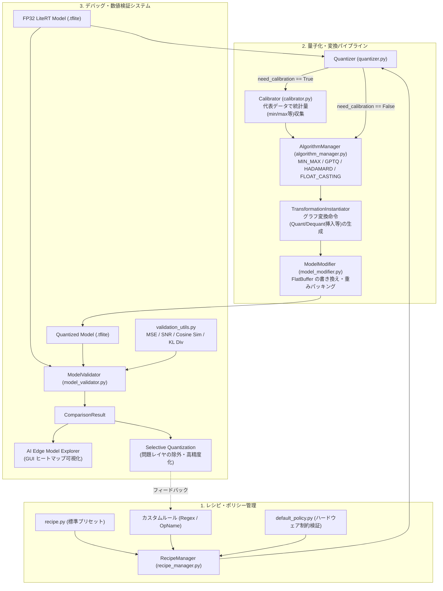

# LiteRT 概要およびモデル量子化・デバッグアプローチ調査レポート

本レポートでは、Google AI Edge エコシステムの中核ランタイムである **LiteRT**（旧 TensorFlow Lite）の概要から、最新の量子化ツールキットである **`ai_edge_quantizer`（LiteRT Quantizer）** の内部アーキテクチャ、そして量子化時の精度劣化を特定・改善するためのデバッグツール群と調整（チューニング）アプローチについて、ドキュメントおよび実装レベルで体系的に解説します。

---

## 1. LiteRT の概要とエコシステム

### 1.1 LiteRT とは
**LiteRT**（Lite Runtime、旧称 TensorFlow Lite / TFLite）は、Google が展開するオンデバイス機械学習基盤 **Google AI Edge** の中核をなす高性能推論ランタイムです。モバイル（Android / iOS）、Web ブラウザ（LiteRT.js）、IoT・組み込み機器上で、従来の視覚・音声モデルから大規模言語モデル（LLM / GenAI）までを低遅延・省メモリで実行するために設計されています。

### 1.2 主要な特徴と進化点
従来の TFLite から LiteRT への進化に伴い、以下の3点が大幅に強化されています。

1. **マルチフレームワーク対応（PyTorch / JAX / TensorFlow）**
   * `ai-edge-torch`（LiteRT Torch）等を通じて、PyTorch の `torch.export` グラフや JAX（StableHLO）から直接 `.tflite`（FlatBuffer 形式）へ高精度・高効率に変換可能になりました。
2. **次世代ハードウェアアクセラレーション（CompiledModel API）**
   * **CPU**: XNNPACK による SIMD / KleidiAI 最適化（INT8 / INT4 / 動的量子化カーネル）
   * **GPU**: OpenCL / Metal / WebGPU デリゲート
   * **NPU**: Qualcomm QNN、MediaTek NeuroPilot、Google Tensor 等への統合 NPU コンパイル・ディスパッチ機構
3. **生成 AI（LiteRT-LM）への本格対応**
   * Gemma、Llama、Qwen などのオンデバイス実行に向け、KV キャッシュ管理、プリフィル／デコード分離、そして後述する **`ai_edge_quantizer` によるサブ8ビット（INT4 / INT2）やブロック単位量子化** が統合されています。

---

## 2. LiteRT におけるモデル量子化の全体像

LiteRT エコシステムでモデルを量子化する経路は、大きく分けて以下の3つが存在します。

| アプローチ | 主なツール / モジュール | 特徴・主なユースケース |
| :--- | :--- | :--- |
| **① Post-Export PTQ（推奨・最新）** | **`ai_edge_quantizer`**<br>(LiteRT Quantizer) | FP32 の `.tflite` モデルを入力とし、レシピベースで動的量子化・静的量子化（SRQ）・Weight-only（INT4/INT8）・混在精度（Mixed Precision）を適用。フレームワーク非依存で最も柔軟。 |
| **② PyTorch Export 時量子化 (PT2E)** | `ai_edge_torch.quantize.pt2e_quantizer`<br>+ `torch.ao.quantization` | PyTorch の FX グラフ段階（`prepare_pt2e` / `convert_pt2e`）でキャリブレーションや QAT（量子化認識学習）を行い、量子化ノードごと `.tflite` に変換するアプローチ。 |
| **③ 従来型 TFLite Converter 量子化** | `tf.lite.TFLiteConverter`<br>+ `QuantizationDebugger` | TensorFlow SavedModel 等からの変換時に `optimizations=[tf.lite.Optimize.DEFAULT]` を指定するレガシー手法。細粒度のレイヤ別制御には制約がある。 |

現在、Google AI Edge において **モデル変換と量子化を疎結合に保ち、レイヤ単位・演算単位で緻密な精度調整やアルゴリズム選択を行う標準ツール** として位置づけられているのが **`ai_edge_quantizer`** です。

---

## 3. `ai_edge_quantizer` のアーキテクチャと実装深掘り

GitHub リポジトリ（`google-ai-edge/ai-edge-quantizer`）で公開されている `ai_edge_quantizer` は、FP32 の `.tflite` FlatBuffer を解析し、ユーザーが定義した「量子化レシピ（Quantization Recipe）」に従ってグラフの書き換え・重み量子化・数値検証を行う Python ツールキットです。

### 3.1 内部モジュール構成と処理パイプライン



各コアモジュールの実装上の役割は以下の通りです。

1. **`quantizer.py` (`Quantizer` クラス)**
   * ユーザー向けファサードクラス。入力モデルとレシピを保持し、`need_calibration` プロパティでキャリブレーション要否を判定します。
   * 主要メソッドとして `load_quantization_recipe()`、`update_quantization_recipe()`、`calibrate()`、`quantize()`、`validate()` を提供します。
2. **`recipe.py` & `recipe_manager.py` (`RecipeManager` クラス)**
   * **`recipe.py`**: よく使われる量子化設定のラッパー関数群を提供します（例：`dynamic_wi8_afp32()`, `dynamic_wi4_afp32()`, `static_wi8_ai8()`, `static_wi8_ai16()`, `weight_only_wi8_afp32()` 等）。
   * **`recipe_manager.py`**: 正規表現（`regex`）と対象オペレーション種別（`TFLOperationName`）の組み合わせでスコープを定義し、演算ごとの量子化設定（`_OpQuantizationConfig`）をリストとして管理します。
   * **実装上の重要仕様（順序依存性）**: `RecipeManager` は登録されたルールを**上から順番に評価し、後から追加されたルールで対象スコープを上書き**します。したがって、`regex=".*"` のような全体デフォルトルールを最初に登録し、特定レイヤの除外（`NO_QUANTIZE`）や高精度化ルールを**後から追加**する必要があります。
3. **`default_policy.py` (Policy Engine)**
   * 指定された量子化設定（例：Activation 8-bit, Weight 4-bit, Channel-wise / Block-wise 等）が、LiteRT の各オペレータ仕様およびターゲットハードウェア（CPU/NPU カーネル）でサポートされているかを検証するポリシー定義です。非対応の組み合わせを指定すると量子化前にエラーを送出します。
4. **`algorithm_manager.py` (`AlgorithmName`)**
   * 量子化パラメータ（Scale / Zero-point）の算出および重み変換アルゴリズムを管理・ディスパッチします。
   * **`MIN_MAX_UNIFORM_QUANT`**: 標準的な一様 Min-Max 量子化。
   * **`GPTQ`**: ヘッセ行列（2次情報）を用いて重み量子化誤差を補償する LLM 向けアルゴリズム。
   * **`HADAMARD`**: 外れ値（Outlier）を持つ活性化・重みに対してアダマール変換（直交回転行列）を適用し、分散を平坦化してから低ビット（INT4 / INT2）量子化する手法。
   * **`FLOAT_CASTING`**: FP32 から FP16 / BF16 へのキャスト。
   * **`NO_QUANTIZE`**: 該当スコープの演算を量子化せず FP32 のまま維持する指定。
5. **`calibrator.py` (`Calibrator`)**
   * Static Range Quantization（SRQ：静的量子化）時に使用されます。代表データセット（Representative Dataset）を FP32 モデルに入力して推論を実行し、全中間テンソルの最小値・最大値（または分布）を収集して `calibration_result` 辞書を生成します。
6. **`transformation_instantiator.py` & `model_modifier.py`**
   * 各テンソルに対する操作（Quantize / Dequantize ノードの挿入、定数テンソルのビットパッキング、スケール調整など）を抽象化した `Transformation` 命令列を生成し、`ModelModifier` が FlatBuffer スキーマを直接書き換えて最終的な `.tflite` バイナリを出力します。

---

## 4. 量子化デバッグツールと精度調整（チューニング）の実践アプローチ

モデルを量子化した際、特に **Full Integer 量子化（`static_wi8_ai8`）** や **低ビット量子化（INT4）** では、特定のレイヤが原因で推論精度が大きく劣化することがあります。`ai_edge_quantizer` 周辺には、この原因を体系的に特定・修正するための強力なデバッグ機構が備わっています。

### 4.1 組み込みデバッグ機構：`ModelValidator` と `ComparisonResult`
`ai_edge_quantizer` には `model_validator.py` および `validation_utils.py` による **テンソル単位の数値検証（Numerical Validation）** 機能が組み込まれています。

* **仕組み**:
  `qt.validate(test_data=..., error_metrics=...)` を呼び出すと、同一の入力データ（未指定時は正規乱数データ）を **元の FP32 モデル** と **量子化後モデル** の双方に流し、対応する全中間テンソル・出力テンソルの値をサイドバイサイドで比較します。
* **評価可能な誤差指標（`validation_utils.py`）**:
  * **MSE** (Mean Squared Error：平均二乗誤差)
  * **SNR** (Signal-to-Noise Ratio：信号対雑音比)
  * **Cosine Similarity** (コサイン類似度：方向の一致度を見るためスケール変動に強い)
  * **KL Divergence** (カルバック・ライブラー情報量：確率分布の乖離度)
* **出力 (`ComparisonResult`)**:
  検証結果は `ComparisonResult` オブジェクトとして返却されます。
  * `comparison_results.get_all_tensor_results()` で全テンソルの誤差統計を辞書として取得し、Python スクリプト上で「コサイン類似度が 0.95 未満のテンソル」や「MSE が急増したノード」をソートして抽出できます。

### 4.2 AI Edge Model Explorer との連携によるビジュアルデバッグ
数値ログだけでは「グラフのどの分岐（Residual 接続や Attention ヘッドなど）で誤差が増幅しているか」を直感的に把握するのが困難な場合があります。そこで **AI Edge Model Explorer (`ai-edge-model-explorer`)** との連携が用意されています。

1. `comparison_results` を JSON 形式で保存（`qt.validate(..., save_folder=...)` 等）。
2. Model Explorer で量子化モデルを開き、検証結果 JSON をオーバーレイとして読み込む。
3. **ノードグラフ上に誤差のヒートマップ（赤色＝誤差大、緑色＝誤差小）が表示**され、どのレイヤで量子化ノイズが発生・伝播したかを視覚的に特定できます。

### 4.3 従来ツール `tf.lite.experimental.QuantizationDebugger` との違い
TensorFlow Lite 時代から存在する `tf.lite.experimental.QuantizationDebugger` も同様のレイヤ別数値検証機能を持ちますが、`ai_edge_quantizer` と比較すると以下の違いがあります。

| 比較項目 | `ai_edge_quantizer` (`ModelValidator` + `RecipeManager`) | 従来型 `tf.lite.experimental.QuantizationDebugger` |
| :--- | :--- | :--- |
| **入力形式** | 変換済みの `.tflite` モデル単体で完結 | `TFLiteConverter` インスタンスと Calibration データが必要 |
| **修正・除外の柔軟性** | 正規表現 (`regex`) と演算種別 (`TFLOperationName`) で、INT16 化・動的量子化・FP16・FP32 維持を自在に混在可能 | `denylisted_ops` / `denylisted_nodes` による FP32 フォールバックのみ |
| **サブ8ビット・LLM対応** | INT4 ブロック量子化、GPTQ、Hadamard 変換に対応 | 基本的に INT8 静的量子化のみが対象 |
| **GUI 連携** | Model Explorer でヒートマップ可視化が可能 | CSV 出力による手動解析が中心 |

---

## 5. 精度劣化時の具体的な調整（チューニング）戦略とコード例

量子化による精度劣化に直面した場合、以下の **4段階のアプローチ** で調整を進めるのがベストプラクティスです。

### ステップ 1: ベースライン量子化と `validate()` によるボトルネック特定
まずは標準レシピ（例：`static_wi8_ai8`）で量子化し、`validate()` でどのテンソル・演算で誤差が発生しているかを特定します。

```python
from ai_edge_quantizer import quantizer, recipe

# 1. モデルの読み込みと標準レシピの適用
qt = quantizer.Quantizer("float_model.tflite")
qt.load_quantization_recipe(recipe.static_wi8_ai8())

# 2. キャリブレーションの実行
if qt.need_calibration:
    calib_result = qt.calibrate(calibration_dataset)
    quant_result = qt.quantize(calibration_result=calib_result)
else:
    quant_result = qt.quantize()

# 3. 検証データでテンソル単位の歪み（誤差）を計測
comparison_result = qt.validate(
    test_data=validation_dataset,
    save_folder="./debug_model_explorer" # Model Explorer 用出力
)

# 4. 誤差が大きい上位テンソルを特定
tensor_results = comparison_result.get_all_tensor_results()
for tensor_name, metrics in sorted(
    tensor_results.items(), key=lambda x: x[1].mse, reverse=True
)[:10]:
    print(f"Tensor: {tensor_name} | MSE: {metrics.mse:.6f} | CosSim: {metrics.cosine_similarity:.4f}")
```

### ステップ 2: 混在精度量子化（Mixed-Precision: `wi8_ai16` の部分適用）
ハードウェアアクセラレータ（NPU 等）の制約で「浮動小数点（FP32）に戻すとデリゲートが分割されて速度が落ちる」場合、問題のあるレイヤの活性化（Activation）だけを **8-bit から 16-bit（INT16）に引き上げる（16x8 量子化）** のが非常に有効です。Softmax 前後、LayerNorm、Sigmoid/Tanh 周辺、または最初の入力層・最後の出力層（Logits）で特に効果を発揮します。

### ステップ 3: 選択的量子化（Selective Quantization: 特定レイヤの FP32 維持）
特定のレイヤ（例：モデルの先頭層、最終分類ヘッド、あるいは外れ値が激しい特定の Attention / Conv ブロック）がどうしても INT8/INT16 に収まらない場合、`RecipeManager` を用いて該当レイヤの正規表現スコープに `AlgorithmName.NO_QUANTIZE`（または `dynamic_wi8_afp32`）を上書き指定します。

```python
from ai_edge_quantizer import quantizer, recipe_manager, qtyping, algorithm_manager

rm = recipe_manager.RecipeManager()

# ① まずモデル全体にデフォルトの INT8 静的量子化ルールを設定
rm.add_static_config(
    regex=".*",
    operation_name=qtyping.TFLOperationName.ALL_SUPPORTED,
    activation_num_bits=8,
    weight_num_bits=8,
    algorithm_key=algorithm_manager.AlgorithmName.MIN_MAX_UNIFORM_QUANT,
)

# ② 感度が高い中間ブロックを 16-bit Activation + 8-bit Weight (wi8_ai16) に引き上げ
rm.add_static_config(
    regex=r".*attention_block_0/.*",
    operation_name=qtyping.TFLOperationName.ALL_SUPPORTED,
    activation_num_bits=16,
    weight_num_bits=8,
    algorithm_key=algorithm_manager.AlgorithmName.MIN_MAX_UNIFORM_QUANT,
)

# ③ 最も劣化が激しい最終出力層 (logits 等) を量子化対象から除外 (FP32 維持)
# ※必ず広域ルール(".*")の「後」に追加してオーバーライドさせる
rm.add_quantization_config(
    regex=r".*(logits|head|final_layer).*",
    operation_name=qtyping.TFLOperationName.ALL_SUPPORTED,
    algorithm_key=algorithm_manager.AlgorithmName.NO_QUANTIZE,
)

# カスタムレシピで再量子化
qt = quantizer.Quantizer("float_model.tflite", quantization_recipe=rm.get_quantization_recipe())
calib_result = qt.calibrate(calibration_dataset)
quant_result = qt.quantize(calibration_result=calib_result)
quant_result.export_model("tuned_mixed_precision_model.tflite")
```

### ステップ 4: LLM / 低ビット量子化（INT4）における Granularity とアルゴリズム調整
LLM や大規模 Transformer を INT4 量子化する場合は、以下のパラメータ調整が鍵となります。
* **Blockwise Quantization（ブロック粒度の細分化）**:
  Channel-wise（チャネル単位）で INT4 量子化すると外れ値1つでスケールが潰れるため、`weight_granularity` をブロック単位（Block size: 128 → 64 → 32）に細かくして局所的なダイナミックレンジを確保します。
* **Hadamard 変換 / GPTQ の適用**:
  外れ値を持つ Linear / MatMul 層に対して `AlgorithmName.HADAMARD` や `AlgorithmName.GPTQ` を指定したレシピを適用し、量子化前の分布を平滑化・誤差補償します。
* **Embedding / LM Head の精度分離**:
  Embedding 層や LM Head（最終出力投影層）は INT4 による劣化が顕著なため、これらを `regex` で指定して INT8（`num_bits=8`）に保つハイブリッドレシピが定石となっています。

---

## 6. まとめ

1. **LiteRT** は従来の TFLite を刷新し、PyTorch / JAX を含むマルチフレームワークと CPU / GPU / NPU の統合アクセラレーション、および生成 AI（LiteRT-LM）を支えるランタイムへと進化しました。
2. 量子化の中核を担う **`ai_edge_quantizer`** は、変換済みの `.tflite` モデルに対して JSON / Python ベースのレシピ（`RecipeManager`）で柔軟に量子化ルールを適用できる設計となっています。
3. デバッグと精度チューニングにおいては、**`ModelValidator` (`qt.validate()`) による全テンソル誤差計測（MSE / SNR / Cosine Similarity）** と **Model Explorer によるヒートマップ可視化** でボトルネック層を特定し、**`RecipeManager` の正規表現オーバーライドによる Selective Quantization（FP32 除外）や Mixed-Precision（`wi8_ai16` / ブロックサイズ変更）** を反復適用するワークフローが最も効果的です。
